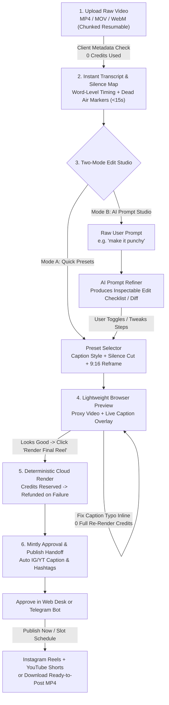

# User-Recorded Video Upload & AI Editor Flow — BA Discovery & UX Specification

> **Ticket:** `MNT-1600` (`MNT-1601`, `MNT-1602`, `MNT-1603`)  
> **Authors:** Wanda Maximoff (Business Analyst, `CDX-013`) & Nick Fury (Project Manager, `CDX-007`)  
> **Status:** `Awaiting User Consent` — **Consent Gate (`MNT-1604`):** Engineering does NOT begin until the user reviews and approves this flow.  
> **Active Skills:** `market-and-competitor-intelligence`, `digital-product-pm`, `conductor-spec-driven-dev`, `unslop-copywriting`

---

## 1. Executive Summary

Creators already record raw talking-head, product-demo, and screen-walkthrough clips on their phones or Loom/OBS—then lose 45–90 minutes bouncing between **Submagic / Captions.ai / CapCut** to cut dead air and add captions, **ChatGPT** to write descriptions, and **Meta Business Suite / YouTube Studio** to schedule.

Competitor teardowns across Trustpilot, Reddit, and G2 show that while AI video tools save initial setup time, users hate **five systemic failures**:
1. **Blind credit burn before preview:** Credits are deducted on upload or failed renders—even when an export crashes or freezes.
2. **Slow full re-renders for a 1-word caption typo:** Fixing a single misspelled technical term or name forces another cloud render queue wait (and sometimes another credit charge).
3. **Black-box AI prompt edits:** Typing *"make it punchy"* triggers opaque edits that chop mid-sentence, insert irrelevant stock B-roll, or wreck pacing with no inspectable diff before rendering.
4. **Audio-to-caption sync drift & clunky timeline editors:** Fast speech or overlapping pauses drift out of sync; web timelines freeze on >150 MB uploads.
5. **Broken or disconnected social publishing:** Third-party schedulers randomly disconnect, drop metadata, or force creators to download and manually upload anyway—and none tie into Mintly's **Telegram approval + multi-platform Reels/Shorts pipeline**.

Mintly solves all five by separating **cheap, instant Transcript & Silence Analysis** from **credit-metered Cloud Rendering**, introducing an **Inspectable AI Prompt Refiner (`EditSpec` Checklist)**, supporting **zero-credit browser preview & inline typo correction**, and handing off approved exports directly into Mintly's existing **Instagram Reels + YouTube Shorts + Telegram Approval** workflow.

---

## 2. Competitor Teardown & Pain-Point Matrix

> **Sources Inspected:** Trustpilot, Reddit (`r/VideoEditing`, `r/podcasting`), G2, and official product workflows for OpusClip, Submagic, Captions.ai, CapCut Web, Descript, Vizard.ai, and VEED.io.

| Competitor | Core Upload -> Edit -> Export Workflow | Pricing & Credit Model | Top 1-Star / 2-Star User Complaints | How Mintly Beats It |
|---|---|---|---|---|
| **OpusClip** (`opus.pro`) | Paste YouTube link or upload long video -> GPT hook analysis + virality score -> auto 9:16 crop + dynamic captions -> optional clip editor -> export / third-party scheduler | Credit-based: **1 min source video = 1 credit**. Free (~60 min, watermarked 720p), Starter ~$15/mo (~150 min), Pro ~$29/mo (~300 min) | **Lost credits on failed/timed-out jobs** after waiting up to an hour; rigid AI clip selection cuts educational/technical nuance; scheduled posts disconnect or fail silently; convoluted cancellation flows | **Zero credits burned on upload/ASR preview**; failed renders auto-refund credits; built specifically for structured creator explainers & talking-head reels; native Telegram + IG/YT publish pipeline |
| **Submagic** (`submagic.co`) | Upload clip -> auto-transcribe -> apply kinetic caption preset + emojis + auto-zoom + "Magic B-rolls" -> timeline text tweak -> cloud render & download | Monthly/yearly tiers by video count & max duration (~$12–$19+/mo Starter up to Pro/Agency); trial is watermarked/limited | **Frozen exports, pixelated re-renders, & audio-caption sync drift** on fast speech; unexpected web downtime during daily posting windows; no built-in IG/YT publishing or Telegram approval; strict no-refund renewals | **Browser proxy preview** catches sync issues before cloud render; **inline caption typo fix** patches subtitle layer without full AI re-pass; 1-click handoff to IG Reels & YT Shorts |
| **Captions.ai** (`captions.ai`) | Record via teleprompter (with AI eye-contact) or import raw clip -> tap "AI Edit" (cuts pauses, zooms, adds music/B-roll) -> word-level captions -> export | Free tier has **0 AI credits** (viewer/trimmer only); paid plans (e.g., Max) start ~$24.99/mo + credit pool for heavy AI/avatars/dubbing | **Aggressive paywall** (cannot test AI edits on free tier); **black-box "AI Edit"** cuts awkward frames or inserts off-topic B-roll; iOS vs Android/Web parity lag; app crashes/unsaved work on larger files | **Two-stage AI Prompt Refiner** shows every proposed cut, zoom, and B-roll slot as toggleable checklist items *before* render; desktop/mobile web parity with chunked resumable uploads |
| **CapCut Web** (`capcut.com`) | Upload to cloud space -> multi-track web timeline -> one-click auto-captions & templates -> export MP4 (local download or TikTok/IG share) | Freemium; **CapCut Pro ~$7.99–$9.99/mo** locks top caption templates, cloud space, AI tools, and clean exports | **Aggressive Pro paywall creep** (free features silently moved to Pro); **web editor crashes on large file uploads**; ByteDance enterprise privacy concerns; no automated daily slot scheduler | **Transparent plan entitlements** (`Lite`/`Starter`/`Creator`/`Pro`), resumable chunked uploads up to 500 MB, GDPR/DPDP compliant storage with 1-click purge, built-in Mintly slot scheduler |
| **Descript** (`descript.com`) | Upload audio/video -> text-based document editor (delete words = cut timeline, remove filler words) -> style captions -> cloud/local export | Limited free tier; paid plans ~$12–$24+/user/mo by transcription hours & AI tools | **Heavy RAM usage & UI lag** on longer projects; cloud sync conflicts causing missing audio or transcript-to-video mismatch; kinetic social captions require tedious manual styling | **Lightweight browser proxy** (no 2 GB Electron/WebAssembly RAM hog) + one-click Hormozi/Minimalist kinetic caption presets ready for 9:16 Reels & Shorts |
| **Vizard.ai** (`vizard.ai`) | Drop long video/link -> AI extracts viral hooks into vertical clips -> auto-highlights keywords -> review/edit -> export | Limited free trial minutes; paid ~$15–$32+/mo by monthly upload minutes & exported clip count | **Awkward mid-sentence cuts**; weak manual editing flexibility compared to timeline tools; users still must rewrite social captions & hashtags separately | **Word-level silence/hook boundary editor** + **auto-generated IG/YT SEO caption, title, & 5 niche hashtags** tailored to the creator's `UserTaste` |
| **VEED.io** (`veed.io`) | Browser upload -> timeline + auto-subtitles + stock assets -> browser/cloud render -> download MP4 | Watermarked free tier; Lite ~$12–$18/mo; Pro/Business ~$30–$50+/mo | **Pricing & export limits**; **browser rendering freezes** if internet drops mid-export; laggy preview with complex animated captions | **Server-side deterministic rendering** with resumable upload + async Telegram/Dashboard completion notification (close tab safely while rendering!) |

### Key Takeaways for Mintly's Competitive Moat
1. **Never charge credits before the creator verifies the transcript and edit plan.**
2. **Never force a black-box AI edit.** Show an **Edit Checklist / Diff** generated by an **AI Prompt Refiner** so creators trust every cut and zoom.
3. **Never trap users in a browser tab during export** or make them download-and-reupload to Instagram and YouTube—connect directly to Mintly's **Approval Queue -> Telegram / Web Preview -> Auto-Publish** engine.

---

## 3. Mintly's Strictly Superior End-to-End User Flow

### 3.1 End-to-End Architecture & State Flow

---

### 3.2 Screen-by-Screen UX & Functional Specification

#### Step 1: Ingest — Resumable Upload Without Fear
- **Entry Point:** New **"Upload & Edit Video"** tab/card inside `/generate` (alongside AI-generated reels) and quick action from `/posts`.
- **Supported Input:** Drag-and-drop or mobile file picker for `.mp4`, `.mov`, `.webm` (H.264 / HEVC / VP9 audio+video).
- **Instant Client-Side Pre-Check (Before Upload Starts):**
  - Reads file header (`<video>` metadata / `mp4box` light probe) in `<500ms` to show duration, resolution, aspect ratio, and file size.
  - Validates against the user's plan limits **before** uploading 300 MB over mobile data.
  - Warns gently if the video has no audio track (*"No spoken audio detected — you can still trim and add music, or upload a clip with voice"*).
- **Chunked Presigned Upload with Pause / Resume:**
  - Direct-to-storage presigned multipart upload (5 MB chunks, 3 concurrent parts, exponential backoff retry).
  - Survives Wi-Fi/5G drops: stores `upload_id` and completed part ETags in `localStorage` so refreshing or switching networks resumes from the last completed chunk.
  - **Credit Rule:** **0 credits deducted** during upload.

#### Step 2: Instant Transcript & Silence Map (`<15 seconds`, 0 Render Credits)
- Once upload completes, Mintly runs fast audio extraction + word-level ASR + Voice Activity Detection (VAD) silence detection.
- **Interactive Transcript & Silence Canvas:**
  - Displays every word with millisecond alignment and highlights detected **dead air (>0.45s)** and **filler words** (`um`, `uh`, `like`) as clickable pill markers (e.g., `[0.8s pause ×]`).
  - Clicking any word seeks the video player directly to that timestamp.
  - **Inline Word Correction:** Creator clicks any misheard word (e.g., *"Kuvernetes"* -> *"Kubernetes"*, *"Mintlee"* -> *"Mintly"*) and edits it immediately **before** rendering.
  - **Click-to-Mute / Cut Segments:** Creator can strike through a stumbled sentence or false start in the transcript (Descript-style) to mark that time range for removal.

#### Step 3: Two-Mode Edit Studio (Quick Presets + AI Prompt Enhancer / Refiner)
The right-hand studio panel offers two complementary modes that always compile into the same transparent **Edit Checklist**:

1. **Mode A — Quick Presets (1-Click Studio Defaults):**
   - **Caption Style:**
     - *Bold Kinetic* (Hormozi-style word-by-word color pop, high contrast, optional context emoji)
     - *Minimal Clean* (Lower-third crisp pill, subtle shadow, zero visual clutter)
     - *Editorial Serif* (Warm creator look, brand accent highlight)
     - *Off* (Clean video)
   - **Caption Position & Safe-Zone Guide:** Toggleable **IG Reels / YT Shorts Safe-Zone Overlay** in the preview player so captions never collide with the bottom description or right-side Like/Comment icons.
   - **Pacing & Framing:**
     - *Cut Silences:* `Off` | `Natural (>0.6s)` | `Tight (>0.3s)`
     - *Remove Filler Words:* Toggle (`um`, `uh`)
     - *Reframe to 9:16:* `Auto Subject Tracking` (for 16:9 landscape recordings) | `Fill / Blur Background` | `Keep Original`
   - **Brand Accent:** Automatically pulls the creator's saved `TasteCadenceConfig` / Brand Kit accent color and narration language (`English` / `Hinglish`).

2. **Mode B — "✨ AI Prompt Enhancer / Refiner" (Mintly's Anti-Black-Box Differentiator):**
   - Creator types a plain-English instruction, e.g.:
     - *"Make this punchy for Instagram Reels, zoom in when I say the 3 mistakes, and keep it under 30 seconds."*
   - Clicking **"Preview Edit Plan"** invokes the **Prompt Refiner** (using video duration, word-level transcript, silence map, and user taste—costing **0 render credits**).
   - **Inspectable, Toggleable Edit Checklist / Diff:**
     Instead of blindly rendering, Mintly displays a structured checklist where every AI decision has a timestamp and an On/Off toggle:
     - `[x]` **Trim dead air:** Remove 4.6s across 7 pauses (`00:02.1`, `00:08.4`, ...)
     - `[x]` **Hook punch-in:** `1.08x` subtle zoom during opening hook (`00:00.0 – 00:02.9`)
     - `[x]` **Emphasis zooms:** `1.10x` cut-in on *"3 costly mistakes"* (`00:07.2`) and *"40% faster"* (`00:19.5`)
     - `[x]` **Captions:** *Bold Kinetic* with brand accent `#10B981`, safe-zone bottom offset `260px`
     - `[ ]` **Background music:** Subtle lo-fi beat ducked to `-22 dB` under voice *(unchecked or toggleable)*
     - `[x]` **Transition SFX:** Soft whoosh (`-14 dB`) at section shift (`00:14.0`)
   - **Result:** Estimated final duration updates live (e.g., `0:38 -> 0:31`), and the creator stays 100% in control.

#### Step 4: Lightweight Browser Proxy Preview & Zero-Waste Inline Typo Fix
- **Before Final Cloud Render:**
  - The browser plays the uploaded video (or a lightweight 540p proxy for >200 MB HEVC MOVs) with a **client-side synchronized caption & zoom/skip preview** driven directly by the `EditSpec` JSON.
  - Creators see exact caption timing, safe-zone clearance, and jump-cut skips *in real time* with **zero cloud render wait**.
- **After Final Cloud Render (Post-Render Typo Fast Path):**
  - If the creator spots a caption typo *after* cloud export (e.g., a misspelled product name), clicking **"Fix Captions"** edits the word text or timing on the existing clean intermediate video (pre-burn intermediate cached for 24h) and runs a **fast caption re-burn pass** in `<15s` at **0 extra credit cost** (up to 3 caption-only patches per rendered video)!
  - Every render saves a non-destructive version (`v1`, `v2`) so the creator can revert anytime.

#### Step 5: Mintly One-Click Approval & Multi-Platform Publish Handoff
Once the final MP4 renders:
1. **Auto-Generated Social Copy:** Using the video's verified transcript + the creator's `UserTaste` (`niche`, `tone`, `target_audience`, `default_language`), Mintly automatically writes:
   - **Instagram Caption** (hook line <=125 chars, SEO keywords, save/comment CTA, up to 5 niche hashtags).
   - **YouTube Shorts Title & Description** (`yt_title`, `yt_description`, tags).
   - Editable right in the final review drawer.
2. **Send to Approval Queue (Web & Telegram):**
   - Creates a `Post` (`kind="reel"`) inside the creator's Mintly workspace (`status="pending"`), matching the exact data contract of AI-generated reels.
   - Sends the **Telegram preview + Approve / Edit Caption / Schedule / Reject buttons** (`src/approve_bot.py`) if Telegram is linked—or keeps it ready in `/posts`.
3. **Publish or Download:**
   - **Schedule to Next Slot** (respects user's `cadence` slots), **Publish Now** to connected Instagram Reels & YouTube Shorts, or **Download Ready-to-Post MP4 + Copy Caption** (`download_only` mode).

---

## 4. Upload Limits, Quotas & Pricing Guardrails

| Plan Tier (`src/plans.py`) | Max File Size | Max Raw Duration | Monthly Video Edits Included | Resolution | Caption Typo Re-Burn |
|---|---|---|---|---|---|
| **Free / No Plan** | 100 MB | 60 sec | 2 trial previews (watermarked export) | 720p | 1 free patch |
| **Lite** (₹699/mo) | 150 MB | 90 sec | 5 uploaded video edits/mo (add-on) | 1080p | Up to 3 free/video |
| **Starter** (₹1,499/mo) | 250 MB | 3 min | 15 uploaded video edits/mo | 1080p | Up to 3 free/video |
| **Creator** (₹2,999/mo) | 500 MB | 5 min | 30 uploaded video edits/mo + AI Prompt Refiner | 1080p | Unlimited patches (24h) |
| **Pro** (₹5,999/mo) | 1 GB | 10 min | 60 uploaded video edits/mo + AI Prompt Refiner | 1080p / 4K | Unlimited patches (72h) |

> **Credit & Quota Integrity Rule:** Credits/quota are **reserved** only when the user clicks **"Render Final Video"**, **committed** only when the final MP4 passes integrity verification (`ffprobe` audio+video streams valid, duration > 0), and **automatically released** on any server/worker error or timeout.

---

## 5. Error & Recovery Matrix

| Failure Scenario | User Experience & Recovery Path | Credit Impact |
|---|---|---|
| **Mobile network drops at 65% upload** | Progress bar pauses cleanly: *"Connection lost — waiting to resume from 65%."* Auto-resumes when online or on tab reopen via saved `upload_id`. | 0 credits used |
| **Unsupported codec / corrupted container (e.g., broken MKV/VFR)** | Client pre-check flags before upload if unreadable; if server probe fails, displays plain message: *"We couldn't read this video format. Export as MP4 (H.264) or MOV and try again."* | 0 credits used |
| **Video has no audio track** | Warning banner on Step 2: *"No spoken audio found. Captions are turned off—you can still trim, reframe, and add music."* | 0 credits used |
| **Transcript / ASR temporarily unavailable** | Automatic 2x retry in background; if still failing, shows *"Could not generate transcript right now. Retry transcription"* button without re-uploading the video. | 0 credits used |
| **AI Prompt Refiner returns ambiguous or unsafe timestamps** | Strict Pydantic bounds validator clamps timestamps to `[0, duration]`, strips invalid operations, and explains adjustments cleanly in the checklist. | 0 credits used |
| **Cloud render fails or times out (>5 min)** | Job moves to `failed`; reserved quota is **immediately refunded**; user receives 1-click **"Retry Render"** and Telegram/UI alert. | **Auto-refunded (0 burned)** |
| **User closes browser during cloud render** | Render continues asynchronously; completion triggers Dashboard badge + Telegram notification with preview link. | Committed on success only |

---

## 6. Anti-Slop UI Copy & Domain Glossary (`unslop-copywriting`)

Never expose internal infrastructure names (`FFmpeg`, `Whisper`, `Deepgram`, `Gemini`, `Cloudinary`, `S3`, `GitHub Actions`, `ASS/SSA`, `EditSpec`, `VAD`, `MVP`) in customer-facing UI copy.

| Avoid (Infra / AI Slop) | Use (Creator-Native Mintly Copy) |
|---|---|
| *"Upload to S3 presigned URL"* | *"Drop your video here — MP4, MOV, or WebM"* |
| *"Running Whisper ASR & VAD silence detection..."* | *"Listening to your clip and marking pauses..."* |
| *"EditSpec JSON generated by Gemini Prompt Refiner"* | *"Suggested Edit Plan — review and toggle any change"* |
| *"FFmpeg filter_complex render in GitHub runner"* | *"Creating your final reel — you can close this tab safely"* |
| *"Re-burn ASS subtitle stream"* | *"Update captions (no extra credit used)"* |
| *"Dispatch to queue_store & Instagram Graph API"* | *"Send to Approval Queue"* / *"Schedule to Instagram & YouTube"* |

---

## 7. Acceptance Criteria for Engineering (`MNT-1604` — Blocked Until User Consent)

- [ ] **AC-1 (Chunked Upload):** Uploading a 250 MB MP4, simulating an offline drop at 50%, and restoring connection resumes cleanly without restarting from 0%.
- [ ] **AC-2 (Zero Pre-Render Burn):** Uploading, transcribing, fixing 5 words in the transcript, and generating 3 AI Prompt Refiner checklists consumes **0 render quota**.
- [ ] **AC-3 (Inspectable Edit Plan):** Entering *"Make this punchy and cut awkward pauses"* renders a toggleable checklist with real timestamps (`00:00.0–00:03.2`) matching the uploaded video's duration; unchecking an item removes it from the rendered output.
- [ ] **AC-4 (Safe-Zone & Browser Preview):** Toggling the IG/YT Safe-Zone overlay in preview shows exact bottom/right UI dead zones; browser preview skips marked cut segments in real time.
- [ ] **AC-5 (Free Typo Re-Burn):** Fixing a caption typo on a completed render produces `v2` in `<20s` without deducting an additional video edit credit.
- [ ] **AC-6 (Auto-Refund on Render Failure):** Simulating a worker failure during final render leaves the user's monthly video edit count unchanged and surfaces a 1-click Retry button.
- [ ] **AC-7 (Mintly Pipeline Handoff):** Clicking **"Send to Approval Queue"** creates a tenant-scoped `Post` (`kind="reel"`), sends the Telegram approval card (if linked), generates IG caption + YT Shorts metadata, and publishes cleanly via `src/publish.py` / `src/publish_youtube.py`.
- [ ] **AC-8 (Anti-Slop Audit):** Automated UI test confirms zero occurrences of `FFmpeg`, `Whisper`, `Gemini`, `Cloudinary`, `S3`, or `EditSpec` in rendered DOM.
